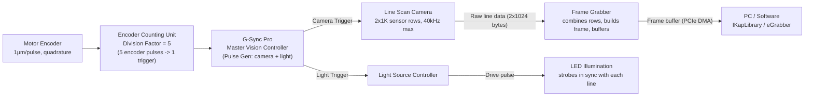
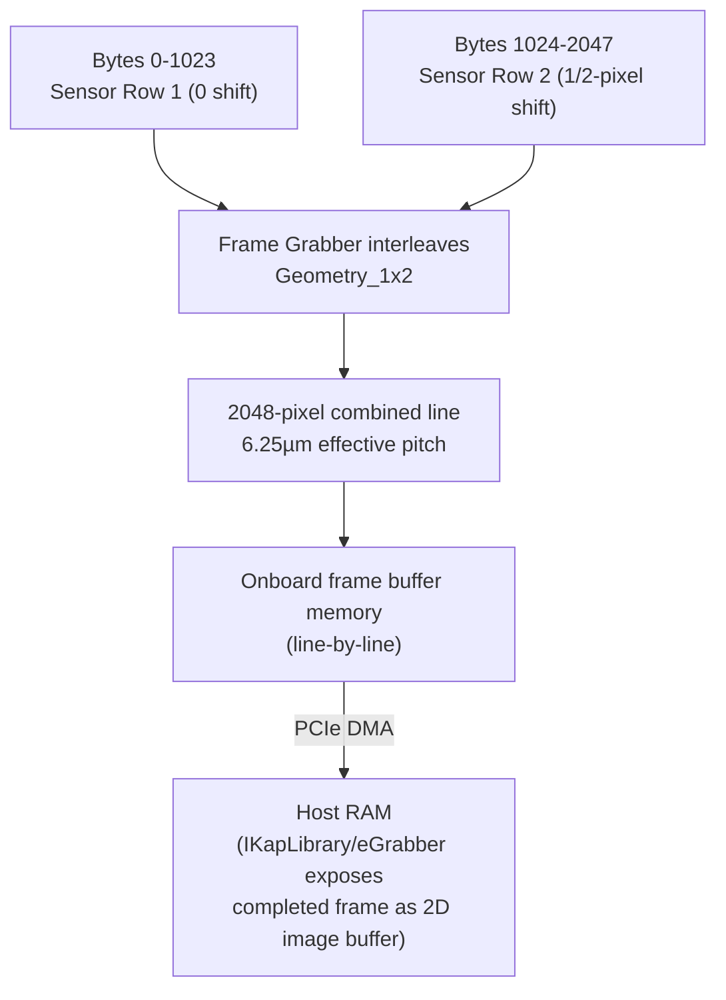
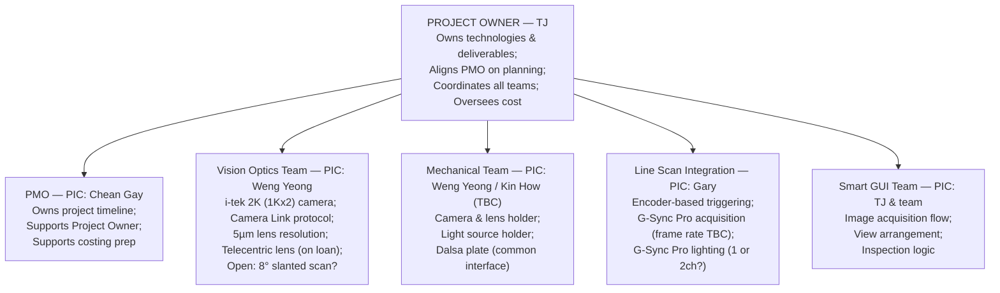

# SWIR Line Scan Camera — Project Kickoff
_Source: `260915_SWIR_Line_Camera_Kickoff.pdf`, 21 pages — ViTrox, Marcus Wong, 14–15 September 2026 (Internal Kickoff + Technical Reference)_

## Summary
This is a **proposal / concept-introduction deck** for a next-generation AOI dual-camera system that replaces the current SWIR **area-scan** secondary camera with a **SWIR line-scan** camera (i-tek TPL2KCL-40KS2, pixel-shift 2K, 950–1700nm), targeting the Skyworks DSM board inspection line. It covers the throughput motivation, team/ownership structure, camera selection and optics, FOV/scan-count math, a detailed technical-reference walkthrough of the encoder→trigger→camera→frame signal chain, two lighting-channel options, the coaxial illumination geometry, and next-step action items. Several values (8° slant scan, frame rate, lighting channel count) are explicitly still open/TBC.

## 1. Background & Goal
**Problem:** the current area-scan system takes **55s per panel** (138 area-scan shots) to inspect a Skyworks DSM panel of 2,520 boards, each only 0.75×0.96mm — small boards force many small-FOV shots, and this is a throughput bottleneck as targets rise.

**Goal:** move to continuous, encoder-synced **line scan** using a pixel-shift SWIR sensor (2× resolution from the same optics) for fewer passes and higher throughput, over a common Dalsa-plate interface that will also support future sensors.

## 2. Team & Responsibilities
| Area | Owner | Scope |
|---|---|---|
| Vision Optics | Weng Yeong | Camera & lens; Camera Link protocol; 5µm telecentric lens; **⚠ open: 8° slant scan** |
| Mechanical | Weng Yeong / Kin How | Camera & lens holder; light source holder; Dalsa plate interface |
| Line Scan Integration | Gary | Encoder triggering; G-Sync Pro frame rate; lighting channels |
| Smart GUI | TJ & team | Acquisition flow; view arrangement; inspection logic |

## 3. Vision Optics — Camera Selection
**Selected camera: i-tek TPL2KCL-40KS2**
| Spec | Value |
|---|---|
| Type | SWIR InGaAs, line scan |
| Spectral range | 950–1700nm |
| Native resolution | 1024px, 12.5µm pitch |
| Pixel-shift resolution | 2048px, 6.25µm effective pitch |
| Max line rate | 40kHz |
| Shutter | Global, TEC-cooled |
| Interface | Camera Link |

**Why this camera:** doubles resolution for free via pixel-shift (two staggered 1K rows interleaved into one 2048-sample line, same optics/FOV); purpose-built for SWIR material contrast that visible/NIR cameras miss; matches the panel's elongated shape (one continuous pass down 179mm beats tiling small FOVs); industrial-rated (TEC-cooled, stable 0–55°C).

**[Diagram: Pixel-Shift Resolution Enhancement]** — two sensor rows (Row 1 = 0 shift, Row 2 = ½-pixel shift) combine into one 2048px output line at 6.25µm effective pitch (down from 12.5µm native). With the team's 5µm native lens, this becomes 2.5µm pixel-shift pitch, giving a scan width of ≈5.1mm at 2× finer resolution.
*Relates to:* the "Why this camera" pixel-shift claim above, and the FOV table in Section 4 (note the FOV entries there use a rounded 5mm figure that needs reconciling with this ~5.1mm math — flagged as an explicit action item).

## 4. FOV & Throughput Analysis
Skyworks DSM panel: 28×90 boards, 0.75×0.96mm each → panel ≈ **49.4mm × 179.0mm**.

| Option | FOV | Boards/Scan | Scans |
|---|---|---|---|
| Existing Area Camera — 5MP | 8.94 × 7.09mm | 5 × 4 | 138 |
| Area Camera — 1MP | 4.97 × 3.73mm | 3 × 2 | 450 |
| Line Scan — 2K Pixel Shift (1K native) | 5mm width | 3 boards in a row | 10 |
| Line Scan — 2K | 7mm width* | 4 boards in a row | 7 |

\* Team-provided figure — flagged in-source as needing reconciliation against the 5µm-lens math (~5.1mm), see Section 3 and Action Items.

*Insight:* line scan cuts the pass count from 138 (today) to 7–10 passes.

**[Chart: Inspection Speed, per-panel cycle time]** — type: bar
- X-axis: configuration index (1–4; **no legend given in source** — bars are not explicitly mapped to the FOV-table rows above, so the pairing below is a plausible-but-unconfirmed reading, not a source-stated fact `[Unclear: best guess, low confidence]`)
- Y-axis: Seconds
- Series: per-panel time

| Config # | Seconds |
|---|---|
| 1 | 55.2 |
| 2 | 14.5 |
| 3 | 10.2 |
| 4 | 20.4 |

Conditions stated on the same slide: operating line rate 32kHz (80% of 40kHz max), cycle overhead +30% (accel/decel per pass, TBC with motion team), panel length 178.96mm.

**Worked example (shown alongside the chart, not one of the 4 bars):** Line Scan 2K, std-res, single lighting → 1.12s/pass × 1.30 overhead = **2.9s/pass** × 10 passes = **29s total**.

*Insight:* overall claim is **2.7×–5.4× faster** than the current area-scan system, even worst-case.

## 5. Technical Reference — Line-Scan Signal Chain

### 5.1 Acquisition pipeline (encoder → triggered image line)
**[Diagram: From Encoder Pulse to Triggered Image Line]**

*Relates to:* worked example on the same slide — stage at 160mm/s → 160,000 pulses/s (1µm/pulse) ÷ Division Factor 5 = **32,000 trigger pulses/s = 32kHz**, matching the 80%-derated operating line rate used throughout Section 4.

### 5.2 Sensor readout & frame build
**[Diagram: Two Sensor Rows In, One Combined Line Out]**

Frame = N lines stacked, where N is set by encoder count; each completed line is written to the buffer as it arrives, and once the panel-length line count is reached the buffer is committed as one frame and transferred to the host.
*Relates to:* the per-line Camera Link byte layout (bytes 0–1023 = row 1, 1024–2047 = row 2) that the pixel-shift interleave in Section 3 depends on.

### 5.3 Speed & exposure configuration
Stage Speed (mm/s) = Line Pitch (µm) ÷ Line Period (µs); Line Period = 1 / Line Rate.

| Step | Value |
|---|---|
| 1. Target line pitch | 5µm (combined 2K pixel-shift image) |
| 2. Derated line rate | 40kHz × 80% = 32kHz (line period = 31.25µs) |
| 3. Required stage speed | 5µm ÷ 31.25µs = **160mm/s** |
| 4. Exposure time | ≤80% of line period = **25µs** (20% guard band for trigger/readout) |

Cross-check via encoder chain: 160mm/s × 1µm/pulse = 160,000 pulses/s ÷ Division Factor 5 = 32,000 triggers/s = 32kHz — confirms the mechanical and trigger paths are self-consistent.

### 5.4 Motion profile & capture window
**[Diagram: Capture Only in the Constant-Velocity Window]** — a trapezoidal speed-vs-distance/time profile with three phases:

| Phase | Speed behavior | Capture active? |
|---|---|---|
| Acceleration | ramps up | No |
| Constant velocity (160mm/s) | flat plateau | **Yes** — line triggers fire only here |
| Deceleration | ramps down | No |

Cycle-time methodology applies a flat **+30% overhead** on top of the constant-speed pass duration to account for these accel/decel ramps. The actual ramp profile (rate, distance) is still **TBC with the motion/mechanical team** (see Action Items #9 in source; overall action list in Section 8 below).
*Relates to:* directly underlies the 1.30× overhead factor used in the Section 4 worked example.

### 5.5 Signal timing (encoder → exposure)
**[Diagram: Timing Diagram, conceptual — 4 stacked signal tracks, not to time scale]**
| Track | Behavior during Acceleration | Behavior during Constant-Velocity Capture Window | Behavior during Deceleration |
|---|---|---|---|
| Encoder Signal (1µm/pulse) | free-running pulses, rate ∝ stage speed | continues free-running (denser, since speed is higher/steady) | free-running pulses |
| Motion Profile | ramping up | flat plateau | ramping down |
| Trigger Signal (32kHz) | none | fires only here, one pulse per line | none |
| Exposure Signal (≤80% of line period, 25 of 31.25µs) | none | one exposure window per trigger, closing before the next trigger | none |

*Insight/relates to:* the encoder free-runs continuously at a rate proportional to stage speed; the Encoder Counting Unit (÷5) gates it into camera line triggers **only** inside the constant-velocity window, and each trigger opens exactly one bounded exposure window — reinforcing that no image capture happens during accel/decel (Section 5.4).

## 6. Lighting Configurations _(Line Scan Integration — Gary)_
**Single channel (simplest to commission):** G-Sync Pro drives the LED continuously on one channel, always on.

Timing: every 31.25µs (32kHz), light always ON, exposure ≤25µs fits inside the 31.25µs period.
**Caution noted on this slide:** exposure is short (5ms vs 0.025ms baseline, i.e. ~200× brighter), so **heat dissipation is important**; team suggests starting at 0.05ms (50µs) drive.

**Dual channel — Option A, Per Pass (recommended start, low risk):** G-Sync Pro toggles the LED channel once per pass — Pass 1 = bright-field (Channel A), Pass 2 = dark-field (Channel B); line-level timing is unchanged from the single-channel case.

**Dual channel — Option B, Per Line (advanced, feasibility TBC):** G-Sync Pro's Light Pulse Generator alternates strobe A/B every trigger, so each channel effectively samples at half rate; switch + LED settle + exposure must all fit within the 31.25µs line period. Open item — confirm with Gary / G-Sync Pro spec.

## 7. Optical Configuration — Camera & SWIR Illumination Geometry
**[Figure: Camera & SWIR Illumination Geometry, schematic — angle enlarged for legibility, actual angle is 8°]** — the line-scan camera sits on the surface normal (0°) above the die; the SWIR line-scan light source is offset **8°** from normal on each side (co-planar with the camera), focused onto the same scan line via a **cylindrical rod lens** ("focusing rod").

**[Figure: Inside the Co-axial Light]** — a beam-splitter illumination path that shares the camera's optical axis: the LED array fires sideways into a 45° partial mirror, which redirects the beam straight down through an aperture onto the die (illumination path), coaxial with the lens above; reflected light returns up through the same partly-transparent splitter into the camera (imaging path).
*Relates to:* this coaxial module is a *separate* illumination option alongside the 8°-offset line light shown in the main geometry figure — both target the same scan line on the die.

## 8. Team Setup / Project Ownership
**[Diagram: Project Ownership & Team Structure]**

*Relates to:* consistent with the Section 2 responsibilities table; this view adds the PMO lane and explicit ownership/coordination framing.

## 9. Action Items & Next Steps
| # | Action | Owner |
|---|---|---|
| 1 | Vendor Q&A with i-tekvision | Weng Yeong |
| 2 | Finalize frame grabber | Weng Yeong |
| 3 | Confirm encoder + accel spec | Gary |
| 4 | Decide lighting approach | Gary |
| 5 | Kick off mechanical design | Weng Yeong / Kin How |
| 6 | Reconcile FOV assumptions | Vision Optics |
| 7 | Begin Smart GUI wireframes | TJ & team |

*Note:* several open items recur through the deck and map onto this list — the 8° slant-scan question (Sections 2, 8), the 5mm vs. ~5.1mm / 7mm FOV discrepancy (Sections 3–4, item #6 above), the accel/decel ramp profile (Section 5.4), and the 1‑ vs 2‑channel lighting decision (Section 6, item #4 above).

---
_Digest condensed from 21 source pages (title/agenda/thank-you pages omitted) to the sections above, including 4 reconstructed tables, 1 chart data table (with an explicitly flagged low-confidence legend inference), 2 schematic figure descriptions, and 4 Mermaid diagrams (acquisition pipeline, sensor readout, single-channel lighting, project ownership)._
