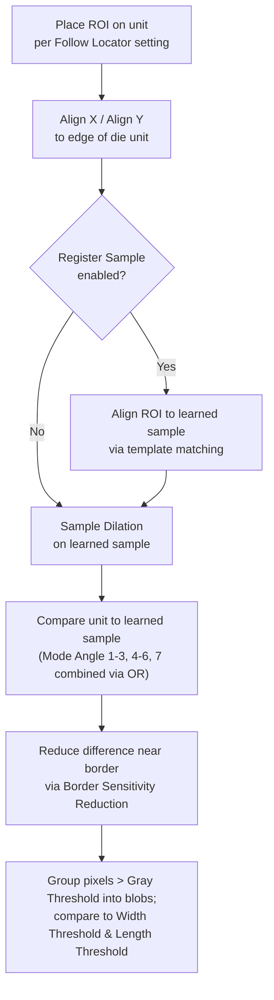
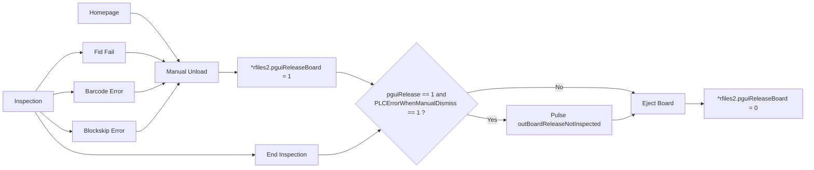

# SW Setup Guideline for DSS Dual Camera System
_Source: `1_5_6_3_DSS_Setup_Guide_Line__RND_Version_.pdf`, 41 pages — applicable to SW v1.5.6.3 or above — internal ViTrox/RND, confidential_

## Summary
This is the RND setup/reference guide for **"DSS" — a generalized dual-camera system** (acronym not expanded in the source). Where the earlier SWIR-only guide hard-wired the secondary camera to SWIR, this version reframes it as an **Auxiliary Camera slot that can be Mono, Color, or SWIR**, sitting alongside a Primary camera that can likewise be any of the three. Most of the plumbing (calibration file, registry switches, view compilation, refdes naming, report files) has been genuinely generalized to "Primary/Auxiliary." **Important exception:** the die-defect inspection algorithm, its error codes, and its AI modes are **still SWIR-specific** in this revision — the source keeps calling that section "SWIR Defect Detection Algorithm" / "SWIR Error Code" verbatim, unlike the generalized sections around it. This digest flags that distinction wherever it matters. Section dates (e.g. "28‑11‑25", "1‑12‑25") mark last-updated revisions and are preserved.

**What's generic now vs. still SWIR-only:**
| Area | Status in this revision |
|---|---|
| Camera hardware (Primary/Auxiliary) | **Generic** — either slot can be Mono, Color, or SWIR |
| Calibration (`.jscale`) | **Generic** — "Applicable to any Auxiliary Camera" (explicit banner in source) |
| Registry switches | **Partly generic** — a new Mono/Color-capable switch was added, but the legacy SWIR-named switch and the internal `SWIR_rep`/`SecondaryLightSource` registry key names were kept for backward compatibility even where they now apply to any Aux camera |
| Lighting controller | **Generic**, plus newly-available Auto Lighting Calibration (not yet for SWIR aux specifically) |
| View compilation, refdes naming, rep file | **Generic** (`tool_head_type`, `-aux` suffix, `.aux_rep`) |
| Die Defect Detection algorithm, its error codes, AI modes | **Still SWIR-only** — unchanged from the SWIR-only guide, section titles still say "SWIR" |
| Configurable Fixed Rail (new section) | **DSS single-lane platform only** |

## 1. Environment Setup _(28‑11‑25)_
- **Cameras:**
  - (Primary) Mono Cam — 25MP, 5120×5120 (~7µm pixel).
  - (Auxiliary) Mono Cam — 25MP, 5120×5120 (~2.5µm pixel) — **for ASE CL only**.
  - **Primary and Auxiliary camera are each independently compatible with any of Mono / Color / SWIR** — the core generalization this guide introduces.
- **Camera firmware:** VTHAL v5.7.1.0; Euresys eGrabber v24.09.0.5; Euresys Memento v24.07.0.13 (unchanged from the SWIR-only guide).
- **Lighting controller:** TLSC G2 Prototype Module, PWM-protected (cuts power if light stays emitted ≥100ms). Mono controller = COM4; **AUX** controller = COM7.
- **Light source:**
  - Mono = `SMT_TC50HB_8CH_COAXIAL` (9 fixed angles for Mono inspection).
  - Aux = RGBW Ring Light for angles 45°, 60°, and Coaxial 90° (**12 fixed angles** for Aux inspection) — **for ASE CL only**. This is a different rig from the SWIR-only guide's SpotLight+Coaxial+Ring Light setup.

## 2. Registry and File Setup _(1‑12‑25)_
| Area | Key | Value / Meaning |
|---|---|---|
| Z-Height | `GUISettings/MZAEnableFlag` | =1 |
| Z-Height | `MachineIO/usingZHeightTeknic` | =1 |
| Z-Height | `cpi/data/config.txt` | contains line `Yes_Z-Height 1` |
| Gantry | `MachineIO/COMPortSafetyCheck` | =1 (retry mechanism for Delta driver init) |
| Gantry | `MachineIO/GantryRetryWarning` | =0 (suppress retry-init motion error prompt) |
| Auxiliary Camera | `FrameStore/SWIR_VTHAL/EnableSWIR` | =1 — legacy main switch; **backward compatible, but now only applies when the Auxiliary Camera is specifically SWIR** |
| Auxiliary Camera | `FrameStore/SWIR_VTHAL/*` | SWIR VTHAL camera settings — SWIR-aux-only |
| Auxiliary Camera | `FrameStore/AuxCamVTHAL/EnableAuxCam` | =1 — **new** main switch, used when the Auxiliary Camera is Mono **or** Color |
| Auxiliary Camera | `FrameStore/AuxCamVTHAL/*` | AuxCamVTHAL settings — Mono/Color-aux-only |
| Aux Lighting | `Unified_light_map.json` | Auxiliary sections added (updated 1/12/25) |
| Aux Lighting | `LightingController/SkipSecurityCheck` | =1 (prevents SWIR angle from dropping — comment text still SWIR-worded) |
| Aux Lighting | `LightingController/EnableSecondaryLightSource` | =1 — main switch for Aux light-source triggering (registry key still named for "SWIR/Secondary" legacy) |
| Aux Lighting | `LightingController/SecondaryLightSource/*` | Auxiliary light source settings |
| Compilation | `GS-1/ForceCompileNormalMode` | =0 |
| Compilation | `Alg/EnableOptimiseZview` | =1 (lets Auxiliary refdes exist in compiled `.jvew`) |
| Result | `ReportFiles/SWIR_rep` | =1 — outputs Auxiliary result to a separate **`.aux_rep`** file (flag name kept as `SWIR_rep` for backward compatibility) |
| Result | `ReportFiles/SWIR_Combine_rep` | =1 (carried over from 1.5.5.1_SWIR_rev2) — combines Primary + Auxiliary result into the same `.rep` file |
| PLC | `MachineIO/default/PLCErrorWhenManualDismiss` | =1 (carried over from 1.5.5.0_SWIR_rev9) — prevents an uninspected board from being sent to the Unloader/outgoing magazine |

*Insight:* the registry layer shows the generalization mid-transition — a brand-new `AuxCamVTHAL` switch exists specifically for Mono/Color auxiliary cameras, while the older `SWIR_VTHAL`/`SWIR_rep`/`SecondaryLightSource` keys were kept as-is (not renamed) and simply reinterpreted to also cover the generic case, for backward compatibility with existing SWIR deployments.

## 3. Software / External Script Compatibility _(28‑11‑25)_
| Software / Script | Compatibility (table header still reads "SWIR Compatibility") | Remarks |
|---|---|---|
| OLP | Not Ready | — |
| VTune | Monitoring | — |
| VTile | Monitoring | Monitor SWIR full board stitching |
| AOIBarcodeGUI | Not Relevant | — |
| AutoImgUploader | Monitoring | Backward compatible with `swir_rep` |
| PNR Decoder | Monitoring | — |
| AiEngine | Not Relevant | — |
| V-Library | Not Relevant | — |
| VUM | Not Relevant | — |

*Note:* several statuses moved to "Monitoring" (a more cautious state than the SWIR-only guide's "Ready"/"Not Ready" calls), and OLP itself is called out elsewhere in the source's table of contents as **"OLP (Not Updated)"** — i.e. this section of the doc has not been revisited for the generic Aux-camera case yet.

## 4. Camera Calibration — `.jscale` _(28‑11‑25 / 2‑12‑25)_
Same file (`cpi/data/scale.jscale`) and mechanism as the SWIR-only guide, now explicitly generalized:
- **`cam_offset`** — distance between **Primary** camera center and **Auxiliary** camera center, used to jog the gantry so the Auxiliary camera sits perpendicular to the selected component's center.
- **`z_axis/cal_height`** — optimum Z-level for calibration; still requires manual adjustment in the Fid Editor UI for best contrast.
- Legacy `cpi/data/scale.xml`/`.vsp` remain **not obsolete**, holding data for the default **Primary** camera only.
- Manual camera calibration is recommended (auto-calibration preferred only for repetition testing); a Google Slides user manual is linked in-source (not reproduced here).
- Source carries an explicit banner: **"Applicable to any Auxiliary Camera."**

**[Figure: `.jscale` tool_head_info structure]** — same three-entry JSON layout as before, with labels updated to the generic terms:
| tool_head_id | Purpose |
|---|---|
| 0 | Scaling data for default **Primary** Cam |
| 1 | Scaling data for **Auxiliary** Cam |
| 2 | Scaling data for Reject Station (etc.) |
*Relates to:* the `cam_offset`/`cal_height` fields above; each entry still carries `cam_skew`, `aspect_ratio`, `high_precision` (x/y pixels, x/y units), and `cam_offset` (x_micron/y_micron), unchanged in shape from the SWIR-only guide.

## 5. Lighting Controller for Auxiliary _(1‑12‑25)_
- New sections added to `unified_light_map.json` for Auxiliary lighting sequence and inspection angle; these are the same three sections as the SWIR-only guide but **renamed generically**: `AuxCam_Calibration_Setting`, `AuxCam_Inspection_Setting`, `AuxCam_Fiducial_Snap_Setting` (previously `SWIR_Calibration_Setting`, etc.).
- **Auxiliary lighting still cannot be auto-generated or validated by the software** — an incorrect JSON file can silently cause Aux lighting to drop.
- Auxiliary Lighting Controller UI is reached via a **toggle button** on the existing Lighting Controller page, now labeled **"AUX Lighting — AUX Mode: ON"** (previously "SWIR Lighting — SWIR Mode: ON").
- **Custom lighting (`.clc`) is still not supported** for Primary or Auxiliary — the file won't load even if enabled.
- **New in this revision:** Auto Lighting Calibration for Auxiliary Lighting **is now available** — but **still not applicable when the Auxiliary Camera is specifically SWIR**.
- **Backward compatible** with `unified_light_map.json` files generated by the earlier SWIR-only software.

**[Figure: `unified_light_map.json` Auxiliary sections + AUX Lighting toggle]** — shows the existing `Inspection_Snap_Setting`/`Fiducial_Snap_Setting` blocks alongside the renamed `AuxCam_Calibration_Setting`, `AuxCam_Inspection_Setting`, `AuxCam_Fiducial_Snap_Setting` blocks, plus a UI toggle switch labeled "AUX Lighting — AUX Mode: ON".
*Relates to:* the toggle-button and renamed-JSON-section points above.

**[Table: Auxiliary Inspection Angle (Mono Cam), dated 1‑12‑25]**
| Angle | Angle Name | Current | Target Grey Mean | Ring Bit (Hex) | Segment Bit (Hex) |
|---|---|---|---|---|---|
| 1 | 60R | — | 80 | 02 | 01 |
| 2 | 60G | — | 80 | 02 | 02 |
| 3 | 60B | — | 80 | 02 | 04 |
| 4 | 60W | — | 80 | 02 | 08 |
| 5 | 45R | — | 80 | 04 | 01 |
| 6 | 45G | — | 50 | 04 | 02 |
| 7 | 45B | — | 80 | 04 | 04 |
| 8 | 45W | — | 80 | 04 | 08 |
| 9 | 90CR | — | 17 | 01 | 01 |
| 10 | 90CG | — | 17 | 01 | 02 |
| 11 | 90CB | — | 17 | 01 | 04 |
| 12 | 90CW | — | 17 | 01 | 08 |

Source annotates row 6 (45G) with **"Please perform Auto Lighting Calibration"** — the "Current" column is left blank throughout, unlike the SWIR-only guide's fully-populated Current column, implying these values are meant to be derived via the newly-available Auto Lighting Calibration (Section 5) rather than hand-set.
*Insight:* 12 fixed angles across 3 light families (60°, 45°, 90° Coaxial) × RGBW — matches the "12 fixed angle" spec and RGBW Ring Light hardware in Environment Setup (Section 1), and is a **Mono-Aux-camera-specific** table (distinct from the SWIR guide's 9-angle SL/CL/RL/BL table).

## 6. Compilation (.jvew)

### 6a. Tool Head Type for View _("Auxiliary Compilation", 1‑12‑25)_
- Every Auxiliary refdes is an **MZA component**.
- Each compiled view carries `tool_head_type`: `0` = Default Cam, `1` = Aux Cam (generalized from the SWIR guide's Mono/SWIR labels).
- **Mixing** non-MZA, MZA, and Aux refdes in one view is still **not possible**.
- View sequence between Normal and Aux views is still inconsistent — grouping is mainly by Z-Height level (e.g. Normal → MZA/Aux at Z-Level 5 → MZA/Aux at Z-Level 8).
- Untrained Aux refdes still go to a separate **Aux MZA view** (vs. untrained normal Aux refdes, which go to the Normal View).

| View type | Contents |
|---|---|
| Normal View | non-MZA / non-Aux refdes only; `tool_head_type = 0` |
| MZA View | MZA + non-Aux refdes; `tool_head_type = 0`; has `mza` height info |
| Aux View | Aux refdes only; `tool_head_type = 1`; has `mza` height info |

**[Figure: sample view JSON in `.jvew`, still labeled "Sample SWIR View" in-source]** — `loc_x`, `loc_y`, `view_id`, `fid_view: false`, `mza: 7.0`, `tool_head_type: 1`, `row_count`, `rows` — identical shape to the SWIR-only guide.

### 6b. Merge View _("MZA / Auxiliary Merge View Compilation", 28‑11‑25)_
This section was an empty placeholder in the earlier SWIR-only guide; it is now filled in:
1. **Not supported for any Auxiliary Camera for now.**
2. Use **auto split component** instead.

## 7. Auxiliary Programming (.plf)

### 7a. Auxiliary Component ("Auxiliary Refdes", 1‑12‑25)
- Refdes naming convention changed: new Auxiliary refdes now end in **`-aux`** (not `-swir`) and still start with the parent refdes name (e.g. `1:die-aux` from `1:die`).
- Aux refdes information still lives only in the **`.plf`** file, not `.plx`.
- **Backward compatibility:** existing refdes already ending in `-swir` are **not renamed**.

### 7b. Auxiliary Device and Algorithm
- Auxiliary refdes can only use an **Auxiliary-specific device type** — still U-type format, `"type": 6` in `.datj`.
- Newly-created Aux device-type names now end in **`-aux`**.
- **Backward compatibility:** existing Aux device types already ending in `-swir` are **not renamed**.

**[Figure: sample Aux refdes in `.plf` / sample Aux device in `.datj`]** — same JSON shapes as the SWIR-only guide (`feature: "swir"`, `swir_type[].ref_des`, `device_type`, `part_number`, `parent`, `shape`, `height`; and `"type": 6` device entries), just with the `-aux` naming convention going forward.
*Relates to:* the naming-migration rules in 7a/7b above.

## 8. Auxiliary Inspection (.aux_rep)

### 8a. Aux Rep File _(1‑12‑25)_
Same two **independent** flags as the SWIR-only guide (registry key names unchanged, output filename generalized):
| `SWIR_rep` | `SWIR_Combine_rep` | Result |
|---|---|---|
| 0 | 0 | (no separate Aux output) |
| 1 | 0 | `.aux_rep` only; `.rep` has normal refdes only |
| 0/1 | 1 | `.rep` has **both** normal and Auxiliary refdes |

- Aux refdes' detailed PNR result is still output together with normal component data in the PNR file.
- **Register name is unchanged from the SWIR software version** (explicit backward-compatibility note in source).

### 8b. SWIR Error Code _(19‑2‑25 — unchanged from the SWIR-only guide, section title still says "SWIR")_
- SWIR refdes still have their **own error code**, with **no association** to, or modification of, the parent refdes' error code.
- Primary error code **Damaged** still carries Sub-Error Codes for finer Die Defect classification, output in `data/error.def`, and viewable at the bottom of the SWIR Algo Editor.

| Primary Error | Secondary Error Code |
|---|---|
| Damaged | Defective, AI Defective |

| New Algorithm | Primary Error | Secondary Error Code |
|---|---|---|
| Die Inspection | Damaged | Defective, AI Defective |

| New Algorithm | PNR Algorithm Name | Has Sub-Error Code |
|---|---|---|
| Die Inspection | `DieDefectInspect` | YES |
| Die Inspection | `DefectDetect` | YES |

**[Figure: `error.def` Damaged entry + SWIR Editor display]** — identical to the SWIR-only guide: `error_code: "8000"`, `error_name: "Damaged"`, sub-codes 1 (Defective) / 2 (AI Defective), shown at the bottom of the SWIR Algo Editor over a defect image.

### 8c. Die Inspection — Sample PNR Output _(19‑2‑25 — unchanged)_
**[Figure: pass vs. fail PNR JSON]** — **Pass:** `error_code: "0"`, ROI = inspection area (or none output). **Fail:** `error_code: "8000"`, `sub_error_code: "1"`, ROI = list of defect-area ROIs.
*Relates to:* concretely shows the Damaged/sub-error-code scheme from 8b in real PNR output.

### 8d. SWIR Defect Detection Algorithm — Operator Walkthrough _(31‑1‑25 → 14‑02‑25 — unchanged from the SWIR-only guide)_
This entire algorithm remains **SWIR-camera-specific** in v1.5.6.3; it was not generalized alongside the rest of the document.

**Quick setup (rule-based, mirror die):**
1. Open the Editor page of a mirror die component and enable the **Defect Detection** algo.
2. Click **+** → **Add Defect Detection**.
3. Draw the **3D Primary Box** to fit the mirror die.
4. Set parameters:

| Parameter | Description |
|---|---|
| Crack Gray Thres Logic | Controls how Crack Gray Thres operates (e.g. "≥ Min" → pixels at/above threshold count as defective). |
| Crack Gray Thres | Simple threshold complementing AI results (e.g. Logic=Min & Threshold=120 → pixels ≥120 are defective). |
| Crack Area Thres | Filters mask by defect size in µm (e.g. =100 → defects <100µm area revert to background). |
| Crack Conf Thres | Filters AI result by AI confidence % (e.g. =50 → only pixels with confidence >50 count as defective). |

**Full setup for small die units (SDI tab)** — steps: (1) Setup edge locator → (2) Setup Die Defect Inspection → (3) Place ROI over the die unit → (4) Learn ≥6 sample units → (5) Fine-tune parameters → (6) Add masking if needed.

**[Diagram: Main Concept of Die Inspection]**


Detailed steps (each tied to a screenshot in source, identical to the SWIR-only guide):
1. Under **Geometry → SDI**, click **+ → Add Die Defect Inspection**.
2. **Draw ROI** to cover the die unit — must **not** include background (✅/❌ example in source).
3. Reset **Box Offset** to 0, tick **Follow Locator**.
4. Turn off **Align X**/**Align Y** (situational — large die units only).
5. Click **Save As Sample** to learn the die pattern. *Important:* if the ROI is resized/moved later, click **Check Sample**, delete all image files in that folder, then relearn.
6. Repeat via **NEXT → Save As Sample** for ≥6 units.
7. Adjust **Gray Threshold** (recommended 6–12) — lower = more sensitive.
8. Adjust **Width Threshold** / **Length Threshold** — shorter defect axis vs. Width, longer axis vs. Length; a defect must fail **both** to be flagged.
9. Advanced settings — **Register Sample** (realign via template matching), **Sample Dilation** (morphological dilation, reduces false calls), **Border Sensitivity Reduction** (reduces false calls near ROI border).
10. **Mask Boxes** for high-contrast, inconsistently-located features: Start → align yellow ROI to die unit → place mask box on the feature → reset yellow ROI offset.

**Related registry keys** (`HKLM\SOFTWARE\WOW6432Node\MV Technology\GS-1\Alg\DieInspection`):
| Key | Unit | Default | Meaning |
|---|---|---|---|
| `DiffMeanFilterRadius` | pixel | 25 | Mean filter applied to the image for normalization |
| `SampleRegRadius` | pixel | 10 | Search radius for Register Sample |
| `SampleRegSkipMargin` | % | 25 | Border of ROI skipped when performing Register Sample |

**A.I. Die Defect Inspection** — supervised and few-shot modes, unchanged from the SWIR-only guide:
- **Supervised:** enable A.I. Anomaly Detection → mode "Supervised" (pre-trained model segments defects) → optionally change image plane → adjust Confidence Threshold (higher = fewer detections, lower = more).
- **Few-shot:** enable A.I. Anomaly Detection → mode "Few-shot" → optionally change image plane (default Coaxial) → open **Blueprint Editor**, save **5 good samples** as blueprints (recommendation: pick dies with the largest visual deviation from the defective region, keep lighting consistent; a warning icon appears if fewer than 5 are saved) → select/​**Save**/​**Remove** refdes in the blueprint list → once >5 exist, pick which blueprint to **replace**.

## 9. OLP _(Not Updated)_
Explicitly called out in the source's table of contents as not yet revisited for this DSS/generic-camera revision — see also Section 3's compatibility table, where OLP shows "Not Ready."

## 10. PLC and Loader Unloader Related

### 10a. Prevent Uninspected Board Flow (carried over, unchanged)
**Problem:** on fid fail, barcode error, or blockskip error, a user's manual board unload previously sent the board straight into the unloader as a "bad board" — an uninspected board could reach the unloader.

**Objective:** implement a software control process so uninspected boards do not flow into the unloader.

- New registry `SOFTWARE\MV Technology\GS-1\MachineIO\default\PLCErrorWhenManualDismiss` (0 = disable, 1 = enable); expected to auto-generate after the first manual unload and be updatable without restarting SmartG.
- **Use case:** enable when an unloader is installed and uninspected boards must not reach it.
- **Logic:** a pre-existing flag `rfiles2.pguiReleaseBoard` is set on any manual unload (fid fail / barcode error / blockskip error all funnel through the same function). If set on entry to `EjectBoard`, the software reloads the registry value; if the new flow applies, it pulses PLC signal **`outBoardReleaseNotInspected`** followed by the normal good/bad board signal. PLC latches this, **stops the board at the exit sensor**, and raises a PLC Error.
- **Known open issue:** conflict between `outBoardReleaseNotInspected` and `outLongBoardAdjustment`, since both pulse alongside the good/bad-board signal but drive different behavior.

**[Diagram: PLC manual-unload flowchart]**


### 10b. Configurable Fixed Rail _(new section — 1‑12‑25 background/problem/solution; 29‑12‑25 software changes)_
**Background:** in customer production — especially backend-semicon specialists — upstream board loading commonly sits at the machine's **left** end, away from the monitor.

**Problem statement:** ViTrox's machine has its fixed rail at the **right** end (close to the monitor), which can't align to a customer conveyor positioned at the left end.

**Proposed solution:** make the fixed-rail position configurable — repositionable with a hex-key screwdriver to **2 designated positions: 350mm and 110mm** — so either left- or right-end upstream conveyors can be accommodated, without needing to refabricate jigs for conveyors ≤110mm wide.

**[Figure: machine top-view schematic]** — a fixed rail **R1** sits at one edge of the machine track; a movable rail **R0** can be set at either **110mm** or **350mm** from R1 (two dashed alternate positions shown side by side). **Downstream** flow exits at the top of the diagram, **Upstream** flow enters at the bottom, and the **Monitor** sits at the right-hand side of the machine — visually tying the "close to monitor" problem statement to the rail geometry.
*Relates to:* directly illustrates the "2 designated positions" and left/right-conveyor accommodation described above.

**Software changes:**
- New PLC signal identifies FR mode: **FR100 = 39.05**, **FR300 = 39.06 (default)**.
- **Auto "Home" adjustment on FR mode change:** "Home" values are the XY offset from gantry location to CAD location on a fiducial point. If "Home" is left unchanged after an FR-mode change, the gantry can fail to reach the correct fiducial location even though a fiducial was previously set — because the board-loading position has shifted.
  - When a loaded program's stated FR mode differs from the current FR mode, an additional offset is applied to "Home," and the new value is saved back to the "home" file together with the current FR mode and max AWA width, using the syntax:
    ```
    r <FR mode> <Max AWA Width>
    ```
    where FR mode: `0 = N/A`, `1 = FR300`, `2 = FR100`.
  - New "Home" (µm) is calculated as:
    ```
    AdjX = Current AWA Width - Home AWA Width
    AdjY = 0
    New Home = Current Home + Adj
    ```
- **As of the last update, this feature is only compatible with the DSS platform, single-lane machine.**

---
_Digest condensed from 41 source pages (title/agenda pages omitted) to the sections above, including 6 reconstructed tables, 7 tied figure descriptions (explicitly noting where source labels/JSON keys still say "SWIR" despite the generalized framing), and 2 Mermaid diagrams (Die Inspection concept flow; PLC manual-unload flowchart), reused unchanged from the SWIR-only guide since that underlying logic did not change in this revision._
