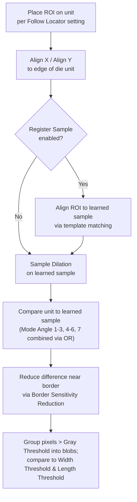
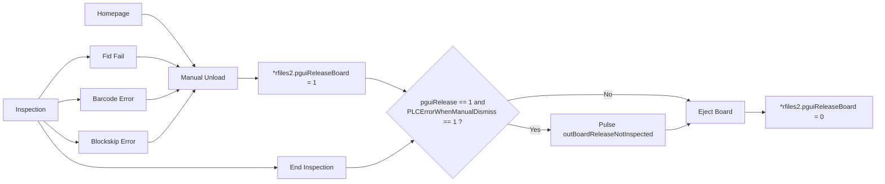

# SW Setup Guideline for SWIR (Area Scan Secondary Camera)
_Source: `1_5_5_X_SWIR_Setup_Guide_Line__RND_Version_.pdf`, 39 pages — applicable to SW v1.5.5.X_SWIR — internal ViTrox/RND, confidential_

## Summary
This is the RND setup/reference guide for the **AOI dual-camera system's first-generation SWIR module**, where the SWIR camera is a second **area-scan** camera bolted onto the existing Mono area-scan inspection head. It covers environment/hardware setup, the registry flags and files that switch SWIR on, the new `.jscale` calibration data model, SWIR-specific lighting control, how SWIR views compile alongside Mono/MZA views, SWIR component/refdes naming, SWIR error-code and report-file behavior, a full operator walkthrough for building the SWIR **Die Defect Detection** algorithm (rule-based + two AI modes), and a new PLC interlock that stops uninspected boards from reaching the unloader. Section dates in the source (e.g. "23‑1‑25", "19‑2‑25") mark last-updated revisions and are preserved below.

## 1. Environment Setup _(23‑1‑25)_
- **Cameras:** Mono — 25MP, 5120×5120. SWIR — 5MP, 2560×2048.
- **Camera firmware:** VTHAL v5.7.1.0; Euresys eGrabber v24.09.0.5; Euresys Memento v24.07.0.13.
- **Lighting controller:** TLSC G2 Prototype Module, PWM-protected (cuts power if light stays emitted ≥100ms). Mono controller = COM4; SWIR controller = COM7.
- **Light sources:** Mono = TC50+ Semicon (9 fixed angles). SWIR = SpotLight + Coaxial + Ring Light for SWIR and Blue light (9 fixed angles).

## 2. Registry and File Setup _(rev updated 1.5.5.1_SWIR_rev2)_
Key registry/config switches (`GS-1` software tree unless noted):
| Area | Key | Value/Meaning |
|---|---|---|
| Z-Height | `GUISettings/MZAEnableFlag` | =1 |
| Z-Height | `MachineIO/usingZHeightTeknic` | =1 |
| Z-Height | `cpi/data/config.txt` | contains line `Yes_Z-Height 1` |
| Gantry | `MachineIO/COMPortSafetyCheck` | =1 (retry mechanism for Delta driver init) |
| Gantry | `MachineIO/GantryRetryWarning` | =0 (suppress retry-init motion error prompt) |
| SWIR Camera | `FrameStore/SWIR_VTHAL/EnableSWIR` | =1 — **main switch** for SWIR feature |
| SWIR Camera | `FrameStore/SWIR_VTHAL/*` | SWIR VTHAL camera settings |
| SWIR Lighting | `Unified_light_map.json` | SWIR sections added (updated 3/2/25) |
| SWIR Lighting | `LightingController/SkipSecurityCheck` | =1 (prevents SWIR angle from dropping) |
| SWIR Lighting | `LightingController/EnableSecondaryLightSource` | =1 — **main switch** for SWIR light triggering |
| SWIR Lighting | `LightingController/SecondaryLightSource/*` | SWIR light source settings |
| Compilation | `GS-1/ForceCompileNormalMode` | =0 |
| Compilation | `Alg/EnableOptimiseZview` | =1 (lets SWIR refdes exist in compiled `.jvew`) |
| Result | `ReportFiles/SWIR_rep` | =1 — output SWIR result to separate `.swir_rep` |
| Result | `ReportFiles/SWIR_Combine_rep` | =1 (rev2) — combine Mono+SWIR result in same `.rep` |
| PLC | `MachineIO/default/PLCErrorWhenManualDismiss` | =1 (rev9) — stop uninspected board reaching Unloader magazine |

## 3. Software / External Script Compatibility _(19‑2‑25)_
| Software / Script | SWIR Compatibility |
|---|---|
| OLP | Ready |
| VTune | Ready |
| VTile | Not Ready |
| AOIBarcodeGUI | Not Relevant |
| AutoImgUploader | Ready |
| PNR Decoder | Monitoring |
| AiEngine | Not Relevant |
| V-Library | Not Relevant |
| VUM | Not Relevant |

Manual SWIR camera calibration is recommended (auto-calibration preferred only for repetition testing). Calibration user manual is linked in-source (Google Slides link, not reproduced here).

## 4. SWIR Camera Calibration — `.jscale` _(23‑1‑25)_
A new file `cpi/data/scale.jscale` stores scaling data per camera/tool head, keyed by `tool_head_id`. Legacy `cpi/data/scale.xml`/`.vsp` are **not obsolete** but now hold data for the default Mono camera only.

New fields in `.jscale`:
- **`cam_offset`** — distance between Mono-camera center and SWIR-camera center, used to jog the gantry so the SWIR camera sits perpendicular to the selected component's center.
- **`z_axis/cal_height`** — optimum Z-level for calibration; must currently be adjusted manually in the Fid Editor UI for best contrast.

**[Figure: `.jscale` tool_head_info structure]** — JSON sample shows three `tool_head_id` entries, each with `cam_skew`, `aspect_ratio`, `high_precision` (x/y pixels, x/y units), `z_axis` (thousands/pixels/cal_height), and `cam_offset` (x_micron/y_micron).
| tool_head_id | Purpose |
|---|---|
| 0 | Scaling data for default Mono Cam |
| 1 | Scaling data for SWIR Cam |
| 2 | Scaling data for Reject Station (etc.) |
*Relates to:* the `cam_offset`/`cal_height` fields described above — this is the concrete file layout housing them.

## 5. Lighting Controller for SWIR _(23‑1‑25 / 3‑2‑25)_
- New sections added to `unified_light_map.json` for SWIR lighting sequence and inspection angle. **SWIR lighting cannot be auto-generated or validated by the software yet** — an incorrect JSON file can silently cause SWIR lighting to drop.
- SWIR Lighting Controller UI is reached via a **toggle button** on the existing Lighting Controller page.
- **Custom lighting (`.clc`) is not supported** for Mono or SWIR — the file won't load even if enabled.
- **Auto lighting calibration for SWIR is not supported** — lighting current is manually defined per application.

**[Figure: `unified_light_map.json` SWIR sections + SWIR Lighting toggle]** — shows `Inspection_Snap_Setting`/`Fiducial_Snap_Setting` (existing, keyed by `Application`) alongside new `SWIR_Calibration_Setting`, `SWIR_Inspection_Setting`, `SWIR_Fiducial_Snap_Setting` blocks, plus a UI toggle switch labeled "SWIR Lighting — SWIR Mode: ON".
*Relates to:* the toggle-button and JSON-section points above.

**[Table: SWIR lighting sequence & inspection angle, dated 3‑2‑25]**
| Angle | Angle Name | Current (Manual Set) | Target Grey Mean (n/a for now) | Ring Bit (Hex) | Segment Bit (Hex) |
|---|---|---|---|---|---|
| 1 | SWIR_SL1 | 175 | 101 | 01 | FF |
| 2 | SWIR_SL2 | 250 | 102 | 01 | FF |
| 3 | SWIR_SL3 | 325 | 103 | 01 | FF |
| 4 | SWIR_CL1 | 125 | 201 | 02 | FF |
| 5 | SWIR_CL2 | 175 | 202 | 02 | FF |
| 6 | SWIR_CL3 | 225 | 203 | 02 | FF |
| 7 | SWIR_RL1 | 600 | 211 | 04 | FF |
| 8 | SWIR_RL2 (blended, same intensity as RL1 to reduce noise) | 600 | 212 | 04 | FF |
| 9 | SWIR_BL | 150 | 221 | 08 | FF |
*Insight:* 9 fixed SWIR angles across 3 light families (SL = spotlight, CL = coaxial, RL = ring, BL = blue), each with fixed current/ring-segment bit codes — matches the "9 fixed angle" spec in Environment Setup.

## 6. SWIR Compilation _(4‑2‑25)_
- Every SWIR refdes is an **MZA component**.
- Each compiled view carries a new `tool_head_type` field: `0` = Default Mono, `1` = SWIR.
- **Mixing** non-MZA, MZA, and SWIR refdes in one view is **not possible**.
- View sequence between Normal and SWIR views is inconsistent — grouping is mainly by Z-Height level (e.g. Normal → MZA/SWIR at Z-Level 5 → MZA/SWIR at Z-Level 8).
- Untrained SWIR refdes go to a **separate SWIR MZA view** (vs. untrained normal MZA refdes, which go to the Normal View).

| View type | Contents |
|---|---|
| Normal View | non-MZA / non-SWIR refdes only; `tool_head_type = 0` |
| MZA View | MZA + non-SWIR refdes; `tool_head_type = 0`; has `mza` height info |
| SWIR View | SWIR refdes only; `tool_head_type = 1`; has `mza` height info |

**[Figure: sample SWIR view JSON in `.jvew`]** — shows a view record with `loc_x`, `loc_y`, `view_id`, `fid_view: false`, `mza: 7.0`, `tool_head_type: 1`, `row_count`, `rows`.
*Relates to:* confirms SWIR views carry both `mza` and `tool_head_type=1` as stated above.

> **Note:** the following slide, "MZA / SWIR Merge View Compilation," is a placeholder in the source (title + empty bullet "1.") — no content was authored yet.

## 7. SWIR Refdes & Rep File _(19‑2‑25 / 17‑2‑25)_
- SWIR refdes names always end in **`-swir`** and start with the parent refdes name (e.g. `1:die-swir` from `1:die`).
- SWIR refdes info lives only in the **`.plf`** file, not in `.plx`.
- SWIR refdes can only use a **SWIR-specific device type** — U-type format, `"type": 6` in `.datj`.

**[Figure: sample SWIR refdes in `.plf`]** — `"feature": "swir"`, with `swir_type[].ref_des: "1:cn1-swir"`, `device_type: "uconn_smd_20flz-sm2-tblfsn-swir"`, `part_number`, `parent: "1:cn1"`, `shape`, `height`.
**[Figure: sample SWIR device in `.datj`]** — `"id": "umcu_qfn-32_6x6x065mm-swir"`, `"type": 6`, nested `user[].id/type`.
*Relates to:* the naming/device-type rules above.

**Rep file output** is controlled by two **independent** flags:
| `SWIR_rep` | `SWIR_Combine_rep` | Result |
|---|---|---|
| 0 | 0 | (no separate SWIR output) |
| 1 | 0 | `.swir_rep` only; `.rep` has normal refdes only |
| 0/1 | 1 | `.rep` has **both** normal and SWIR refdes |

SWIR detailed PNR results are output together with normal component PNR results in the PNR file.

## 8. SWIR Error Code _(19‑2‑25)_
- SWIR refdes have their **own error code** — for now it does **not** associate with, or modify, the parent refdes' error code in any way.
- Primary error code **Damaged** was expanded with sub-error codes for finer Die Defect classification, output in `data/error.def`.
- Sub-error codes: `Damaged` → `1 = Defective`, `2 = AI Defective`.
- Damaged sub-error code is also viewable at the bottom of the SWIR Algo Editor.
- New algorithm **Die Inspection** (PNR algo names `DieDefectInspect`/`DefectDetect`) raises `Damaged` with these sub-codes; both algo names have sub-error-code support.

**[Figure: `error.def` Damaged entry + SWIR Editor display]** — JSON `error_code: "8000"`, `error_name: "Damaged"`, `sub_error_list` with codes 1 (Defective) and 2 (AI Defective); paired screenshot shows the Damaged/Defective sub-error labels rendered at the bottom of the SWIR Algo Editor over a defect image.
*Relates to:* the sub-error-code point above.

## 9. Die Inspection — Sample PNR Output _(19‑2‑25)_
**[Figure: pass vs. fail PNR JSON, refdes `3:strip-p-1-swir` vs `3:strip-p-9-swir`]**
- **Pass sample:** `error_code: "0"`; `details[].roi` = the inspection area itself (or no ROI output at all).
- **Fail sample:** `error_code: "8000"`, `sub_error_code: "1"`; `details[].roi` = list of defect-area ROIs (with `x`, `y`, `dx`, `dy`, `max_Threshold`, `results`, `unit`).
*Relates to:* shows concretely how the Damaged/sub-error-code scheme from Section 8 appears in real PNR output.

## 10. SWIR Defect Detection Algorithm — Operator Walkthrough _(31‑1‑25 → 14‑02‑25)_

### 10.1 Quick setup (rule-based, mirror die)
1. Open the Editor page of a mirror die component and enable the **Defect Detection** algo.
2. Click **+** and choose **Add Defect Detection**.
3. Draw the **3D Primary Box** to fit the mirror die.
4. Set parameters (table below).

**[Figure: SWIR editor screenshot]** — left panel lists Body Presence checks (Locator, Joint, Polarity, Barcode, Bridge, Ringer, 3D checks, Gap Detector, SDI, Measurements, Solder Ball) with **Defect Detection** checked and "Add Defect Detection" highlighted; right panel shows the mirror-die image with a green 3D Primary Box drawn around a shape with visible dark speckled defects.
*Relates to:* steps 1–3 above.

| Parameter | Description |
|---|---|
| Crack Gray Thres Logic | Controls how Crack Gray Thres operates. E.g. "≥ Min" means only pixels with intensity ≥ threshold count as defective. |
| Crack Gray Thres | Simple threshold to complement AI results. E.g. Logic=Min & Threshold=120 → pixels ≥120 are defective. |
| Crack Area Thres | Filters mask result by defect size (µm). E.g. =100 → defects <100µm area are reverted to background. |
| Crack Conf Thres | Filters AI result by AI confidence (%). E.g. =50 → only pixels with AI confidence >50 count as defective; rest = background. |

### 10.2 Full setup for small die units (SDI tab)
Main steps: (1) Setup edge locator → (2) Setup Die Defect Inspection → (3) Place ROI over the die unit → (4) Learn ≥6 sample units → (5) Fine-tune parameters → (6) Add masking if needed.

**[Diagram: Main concept of Die Inspection]** — conceptual pipeline, structured as:

*Relates to:* the 7-step "Main Concept of Die Inspection" text and drives every setting described below.

Detailed steps (each tied to a screenshot in source):
1. Under **Geometry → SDI**, click **+ → Add Die Defect Inspection**.
2. **Draw ROI** to cover the die unit — must **not** include surrounding background (source shows a ✅ correctly-cropped vs. ❌ over-cropped example).
3. Reset **Box Offset** to 0 and tick **Follow Locator**.
4. Turn off **Align X**/**Align Y** (situational — only for large die units).
5. After locator setup, click **Save As Sample** to learn the die pattern. *Important:* if the ROI needs resizing/moving afterward, click **Check Sample**, delete all image files in that folder, then relearn.
6. Repeat learning via **NEXT → Save As Sample** for ≥6 units.
7. Adjust **Gray Threshold** (recommended 6–12) — lower = more sensitive.
8. Adjust **Width Threshold** / **Length Threshold** — a defect's shorter axis is checked against Width, longer axis against Length; a defect must fail **both** to be flagged.
9. Advanced settings:
   - **Register Sample** — realigns ROI to the learned sample via template matching.
   - **Sample Dilation** — morphological dilation on the learned sample; reduces false calls in some situations.
   - **Border Sensitivity Reduction** — reduces the difference score near the ROI border to cut border false calls.
10. **Mask Boxes** — for high-contrast features at inconsistent locations across units, mask them out to reduce false calls. Setup sequence: Start → align yellow ROI to the die unit → place mask box on the feature → reset yellow ROI offset.

**Related registry keys** (`HKLM\SOFTWARE\WOW6432Node\MV Technology\GS-1\Alg\DieInspection`):
| Key | Unit | Default | Meaning |
|---|---|---|---|
| `DiffMeanFilterRadius` | pixel | 25 | Mean filter applied to the image for normalization |
| `SampleRegRadius` | pixel | 10 | Search radius for Register Sample |
| `SampleRegSkipMargin` | % | 25 | Border of ROI skipped when performing Register Sample |

### 10.3 A.I. Die Defect Inspection
General concept: supervised learning and few-shot learning act as a supporting tool for defect detection; users can enable/disable A.I. anomaly detection per inspection criteria, and adjust a Confidence Threshold to tune outputs (higher threshold → fewer detections; lower → more).

**Supervised mode:**
1. Enable **A.I. Anomaly Detection**, mode = **Supervised** (uses a pre-trained model to segment die defects).
2. Change the default **image plane** if defects aren't clear on it.
3. Adjust **Confidence Threshold** (example shown: 45%) to tune detections.

**Few-shot mode:**
1. Enable **A.I. Anomaly Detection**, mode = **Few-shot**.
2. Change **image plane** if defects aren't clear on the default (Coaxial).
3. Open **Blueprint Editor** and save **5 good samples** as blueprints for the model to learn (example Confidence Threshold shown: 65%). *Recommendation:* pick good dies with the largest visual deviation from the defective region, and keep lighting consistent across samples. A warning icon appears if fewer than 5 blueprints are saved.
4. In Blueprint Editor, select good samples from the refdes list; click **Save** to add the selection as a blueprint, or **Remove** to drop it from the pool.
5. Once >5 samples exist, users are prompted to pick which existing blueprint to **replace** with the new one.

**[Figure: Blueprint Editor UI]** — left pane shows a die image (a white masked shape over a textured background) with a scrollable **Temporary Blueprint List** of refdes (eye icons toggle visibility); a second view shows a **Finalized Blueprint List** with "New" vs "Leaving Soon" comparison panels and a **Replace** control.
*Relates to:* Few-shot steps 3–5 above.

## 11. PLC and Loader/Unloader — Prevent Uninspected Board Flow _(1.5.5.0_SWIR_rev9)_

**Problem:** On fid fail, barcode error, or blockskip error, a user's manual board unload previously sent the board straight into the unloader as a "bad board" — i.e. an **uninspected board could reach the unloader**.

**Objective:** implement a software control process so uninspected boards do not flow into the unloader.

**Setup:**
- New registry `SOFTWARE\MV Technology\GS-1\MachineIO\default\PLCErrorWhenManualDismiss` (0 = disable, 1 = enable).
- Intended to auto-generate after the first manual unload, and to be updatable without restarting SmartG (per source; theoretical/expected behavior).
- **Use case:** enable this when an unloader is installed and uninspected boards must not reach it.

**Implementation logic:**
- A pre-existing flag `rfiles2.pguiReleaseBoard` is set whenever the user executes the unload-board function from the frontend; fid fail, blockskip error, and barcode error all funnel through that same function, so the flag doubles as a "was this a manual unload" signal.
- If the flag is set on entry to `EjectBoard`, the software reloads the new registry value and decides whether to take the new PLC flow.
- If yes, a new PLC signal **`outBoardReleaseNotInspected`** is pulsed, followed by the normal good/bad board signal. PLC latches this and **stops the board at the exit sensor** even though a good/bad signal was received, then raises a PLC Error notifying the user the board is stopped there.
- **Known open issue (future enhancement):** need to handle a signal conflict between `outBoardReleaseNotInspected` and `outLongBoardAdjustment`, since both pulse alongside the good/bad-board signal but drive different behavior.

**[Diagram: PLC manual-unload flowchart]**

*Relates to:* the "Implementation logic" bullets above — reproduces the exact branch structure from the source flowchart, including that `End Inspection` reaches the decision directly while the three error paths and manual unload go through the `pguiReleaseBoard = 1` flag first.

---
_Digest condensed from 39 source pages (title/agenda pages omitted) to the sections above, including 4 reconstructed tables, 6 tied figure descriptions, and 2 Mermaid diagrams (Die Inspection concept flow; PLC manual-unload flowchart)._
