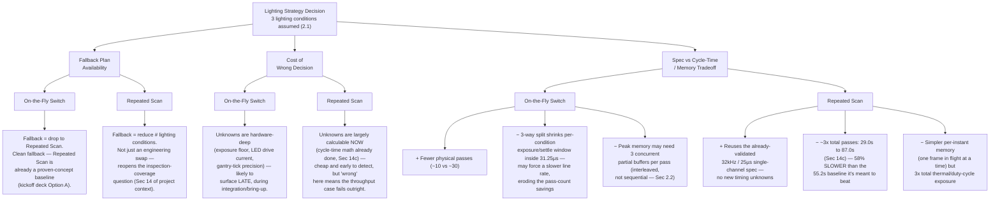

# AOI Line-Scan Software Development — Context

**Scope:** Software-side design questions for the SWIR Line Scan project (scan ROI compilation, buffering, lighting-switch strategy) — tracked **separately** from the hardware/project-management context in `swir-line-scan-project-context.md` and from `op2-semicon-laser-linescan-context.md`. Same underlying project, but this document is for the Smart-GUI/software-architecture thread specifically.

**Status legend:** ✅ Resolved · 🔁 Refined/corrected · 🟡 Still open

---

## 1. View Compilation & Buffering Strategy

### 1.1 Why the existing view model doesn't carry over directly
The existing area-scan view-compilation model (Normal / MZA / SWIR view, keyed by `tool_head_type` + Z-height) was built around a "view = one discrete gantry-positioned snapshot" assumption. Line-scan breaks that: a "view" no longer corresponds to a physical camera position — it becomes a **virtual crop definition** (an X-strip range + Y-range + refdes list) applied against a continuous, encoder-driven frame stream. This is the same gap already flagged in `swir-line-scan-project-context.md` (open item #13, Milestone 2 completion criterion #5) — the item below is one proposed way to close it, specifically for the case where lighting also has to be a partition axis.

### 1.2 Memory footprint — why this isn't abstract
One full-length line-scan pass, single lighting condition:
- Panel length ≈ 178.96mm ÷ 5µm line pitch ≈ **35,800 lines**
- 2048px/line (post pixel-shift interleave, already combined by the frame grabber before host RAM)
- Assuming 16-bit packing (🟡 **assumption** — SWIR InGaAs is typically 10–12 bit output; actual host packing not yet confirmed with Weng Yeong / frame grabber config) → **~140MB per single-lighting, single-strip pass**

Full panel coverage = 10 X-strips. If every strip needed 2 lighting conditions, that's 20 passes; naively holding all captured frames before processing ≈ **~2.8GB**. This is the number that should drive the buffering-strategy decision, not a general "be careful with memory" intuition. (See Section 2 below — this now needs to be re-run at **3** lighting conditions, not 2.)

### 1.3 Three buffering strategies

| Strategy | Mechanism | Memory footprint | Complexity | Best fit |
|---|---|---|---|---|
| **A. Full-pass buffer, then crop** | Frame grabber commits the full ~140MB frame to host RAM; software crops all lighting-matched ROIs against it, then releases | High (~140MB × concurrency factor) | Low — this is what Milestone 2's own completion criteria (#3, #4) already have to validate anyway | v1 / bring-up phase |
| **B. Sliding-window streaming crop** | Hook the line-by-line stream before full-frame commit; accumulate only the Y-line-ranges belonging to ROIs tagged for the current pass's lighting condition, discard the rest as it streams | Low — bounded by sum of ROI sizes, not full panel | High — needs real-time encoder-position-to-line-index mapping, buffer manager independent of "frame complete" semantics | Once M2 shows memory pressure is real |
| **C. Windowed batch buffer (per-board-row)** | Ring-buffer sized to one repeating board-row unit (panel is periodic — 90 rows), process/crop against that window, reuse for next row | Bounded to a small multiple of one row's lines | Medium | Middle ground if B proves too invasive against the frame grabber SDK on this timeline |

**Recommendation:** don't build B or C until M2 actually shows Strategy A is a problem — sustained full-frame buffering is something M2's own test criteria force you to validate anyway. Treat B/C as fallback optimizations, not day-one requirements (same logic the project already applies to the VTHAL fallback plan: decouple, prove the pipeline first, treat the harder integration as a fast-follow).

### 1.4 Lighting as a first-class partition axis (schema note)
Extend the `.jvew` view record with a `lighting_id` field alongside the existing `tool_head_type`/`mza` fields:

```json
{ "view_id": "...", "tool_head_type": 1, "mza": 7.0, "lighting_id": "bright_field", "row_count": "...", "rows": [...] }
```

Same validation rule that already applies to `tool_head_type` ("mixing non-MZA/MZA/SWIR refdes in one view is not possible") should extend to lighting: a view cannot mix refdes needing different lighting conditions, since one physical pass can only deliver one lighting condition. Untrained/untagged refdes should default into the baseline lighting condition (whichever ends up being the "simplest to commission" one), mirroring the existing untrained-SWIR-refdes fallback rule.

### 1.5 Pass-plan ordering (motion-sequencing note)
Compile the physical scan order **grouped by lighting condition across the whole panel**, not per-strip-then-per-lighting: i.e. all 10 strips under Lighting A first (serpentine X-stepping, no full Y fly-back needed between strips), then all 10 under Lighting B, etc. Interleaving strip-by-strip (strip 1 A → strip 1 B → strip 2 A …) forces a full Y fly-back after *every* pass instead of every lighting-group, roughly doubling dead time for the same total pass count. This is a Gary/motion-team detail, but it should fall out of how the pass plan is generated in software, not be decided ad hoc at runtime.

### 1.6 Open question carried forward
🟡 Can the trigger be spatially gated **within** a pass (on/off at specific Y-positions), or only at pass start/end? If gating mid-pass is possible, a second lighting pass covering only some refdes doesn't need to re-scan the full panel length — just the relevant Y-ranges. Currently the only confirmed gating behavior is the constant-velocity window (accel/decel exclusion), not arbitrary ROI-based gating. Needs confirmation with Gary's team; directly affects Section 2 below.

---

## 2. Lighting Strategy Decision: On-the-Fly Switch vs. Repeated Scan

### 2.1 New assumption driving this section
**Assume 3 distinct lighting setups are required**, not 2. (🟡 Working assumption — this likely traces back to `swir-line-scan-project-context.md` Section 14b's finding that reliable crack detection needs "at least 3 spotlight images at different currents," but that hasn't been formally confirmed as *the* set of 3 vs. some other combination of bright/dark/coaxial conditions. Worth nailing down with whoever owns the die-defect algorithm before this becomes a hard design constraint.)

This reframes the two lighting options already on record in the kickoff deck (Section 4/6 of the SWIR kickoff digest) from a 2-channel to a **3-channel** question:

| Kickoff deck's original framing | This section's reframing |
|---|---|
| Option A — Per-Pass (2 channels): recommended low-risk baseline | **Repeated Scan** — same idea, extended to 3 full passes |
| Option B — Per-Line (2 channels): advanced, feasibility TBC | **On-the-Fly Switch** — same idea, extended to 3-way switching within a pass |

### 2.2 Strategy 1 — On-the-Fly Light Switch (within one continuous pass)
One physical pass covers all 3 lighting conditions by switching lighting mid-pass (extending the kickoff's "Per-Line" concept from 2 to 3 channels).

**Unknowns:**
- 🟡 Minimum camera exposure time achievable once the already-tight 31.25µs (32kHz) trigger period has to accommodate switching across **3** lighting conditions instead of 2 — does the per-condition timing budget still leave a workable exposure window?
- 🟡 How slow the gantry can go while maintaining precise pulse ticking — i.e. is dropping stage speed (and therefore line rate) a viable lever to buy back per-condition timing budget, and how far can it drop before it conflicts with other constraints already on record (the 0.5µm encoder-precision stability ceiling, and the throughput case itself)?
- 🟡 Current required to drive sufficiently strong light output within a shortened pulse window — fast, strong emission in a short window still needs high drive current, which raises heat-per-pulse even though the pulse itself is brief. This is a distinct heat concern from Strategy 2's sustained-emission heat concern below.
- 🟡 Memory needed to hold a full-board buffer across all 3 lightings — since per-line switching means the 3 conditions' data arrive **interleaved within a single pass's line stream**, do all 3 need to be held and reconciled in memory simultaneously before they can be split into 3 usable images? (This is a materially different memory shape than Strategy 2, which produces the 3 images sequentially — see Section 2.4.)

### 2.3 Strategy 2 — Repeated Scan (one lighting condition per full pass, constant light emit)
Three separate full-length passes, one per lighting condition, each with the light held constant/always-on (extending the kickoff's "Per-Pass" baseline from 2 to 3 passes).

**Unknowns:**
- 🟡 How long the light can emit continuously before burn/thermal damage risk — now sustained across **3** full passes instead of the originally-scoped 1–2, tripling total duty-cycle exposure.
- 🟡 Whether heat buildup during that sustained emission degrades image quality — either through LED output drift or sensor-side thermal effects over a multi-second continuous pass.
- 🔁 **This one is already numerically resolved, not fully open** — `swir-line-scan-project-context.md` Section 14c already ran this math: 1 lighting condition = 10 passes = 29.0s; 2 conditions = 20 passes = 58.0s (5% slower than the 55.2s area-scan baseline); **3 conditions = 30 passes = 87.0s — 58% slower than the baseline.** So the cycle-time cost of Repeated Scan at 3 lighting conditions isn't an unknown to go measure — it's already a known, and it already contradicts the project's core throughput justification.

### 2.4 Decision Map

Organized around the three axes requested: fallback availability, cost of getting it wrong, and the spec ↔ cycle-time/memory tradeoff.



### 2.5 Reading the map
- **Fallback favors On-the-Fly** — if it doesn't pan out, dropping to Repeated Scan is a known-working retreat. Repeated Scan's own fallback (fewer lighting conditions) isn't really a fallback so much as a renegotiation of what the algorithm needs.
- **Cost-of-wrong-decision cuts the other way** — Repeated Scan's failure mode is cheap and early to detect (it's arithmetic, already done); On-the-Fly's failure mode is hidden inside hardware unknowns that may only surface after real integration effort has already been spent on 3-way-switching electronics/timing.
- **The tradeoff branch is where it gets genuinely uncertain for both** — On-the-Fly's headline advantage (fewer passes) is not guaranteed to survive once the per-condition timing budget and peak-memory shape are actually worked out; Repeated Scan's cycle-time cost is not in question, but its per-instant memory and hardware risk are lower.

**Net effect:** this isn't a clean call from the map alone — it's a genuine build-vs-verify tradeoff. On-the-fly has better strategic fallback but a riskier, later-discovered cost; repeated scan has a known cost today that may already be disqualifying on throughput grounds alone, unless the 3-lighting-condition assumption itself (2.1) gets revisited first.

### 2.6 Open questions to bring back
- Is 3 the confirmed number of lighting conditions, or a working assumption that still needs sign-off from whoever owns the die-defect algorithm? (This gates everything else in Section 2.)
- Can Gary's team give an early, even rough, answer on the exposure-floor and current-draw unknowns for 3-way on-the-fly switching, before committing hardware design effort either direction?
- Does the mid-pass trigger-gating question (Section 1.6) change the Repeated Scan cost — i.e., can a second/third pass be scoped to only the relevant sub-regions instead of a full re-scan, softening the 87.0s figure?

---
